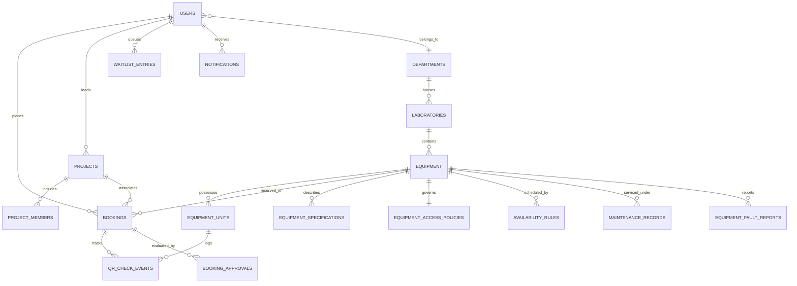

# LabLink — Database Architecture & Schema Specification

**Engine**: PostgreSQL 16 / SQLite (Local Dev)  
**ORM**: SQLAlchemy 2.0 (Declarative Base with UUID Primary Keys)  
**Migrations**: Alembic

---

## Entity Relationship Overview

---

## Detailed Table Definitions

### 1. `users`
| Column | Type | Constraints | Description |
| :--- | :--- | :--- | :--- |
| `id` | VARCHAR(36) | PRIMARY KEY | UUID string |
| `email` | VARCHAR(255) | UNIQUE, NOT NULL, INDEX | Institutional email |
| `hashed_password` | VARCHAR(255) | NOT NULL | Argon2id hash |
| `full_name` | VARCHAR(150) | NOT NULL | Full name |
| `role` | ENUM | NOT NULL | `STUDENT`, `FACULTY`, `ADMIN` |
| `department_id` | VARCHAR(36) | FOREIGN KEY -> departments(id) | Nullable for global admins |
| `student_id` | VARCHAR(50) | UNIQUE, NULLABLE | e.g. STU-2026-081 |
| `is_active` | BOOLEAN | DEFAULT TRUE | Account lock flag |
| `created_at` | TIMESTAMP | DEFAULT UTC NOW | Creation timestamp |

### 2. `equipment`
| Column | Type | Constraints | Description |
| :--- | :--- | :--- | :--- |
| `id` | VARCHAR(36) | PRIMARY KEY | UUID string |
| `department_id` | VARCHAR(36) | FOREIGN KEY -> departments(id) | Owning department |
| `laboratory_id` | VARCHAR(36) | FOREIGN KEY -> laboratories(id) | Physical location |
| `name` | VARCHAR(200) | NOT NULL, INDEX | Equipment name |
| `category` | VARCHAR(100) | NOT NULL, INDEX | e.g. Embedded, FPGA, GPU |
| `model_number` | VARCHAR(100) | NULLABLE | Manufacturer model |
| `serial_number` | VARCHAR(100) | UNIQUE, NOT NULL | Serial tracking code |
| `description` | TEXT | NOT NULL | Technical overview |
| `status` | ENUM | NOT NULL | `AVAILABLE`, `MAINTENANCE`, `DECOMMISSIONED` |
| `is_restricted` | BOOLEAN | DEFAULT FALSE | Requires faculty approval if true |
| `total_quantity` | INTEGER | NOT NULL, DEFAULT 1 | Total inventory count |
| `available_quantity`| INTEGER | NOT NULL, DEFAULT 1 | Current free units |

### 3. `bookings`
| Column | Type | Constraints | Description |
| :--- | :--- | :--- | :--- |
| `id` | VARCHAR(36) | PRIMARY KEY | UUID string |
| `equipment_id` | VARCHAR(36) | FOREIGN KEY -> equipment(id) | Target equipment |
| `student_id` | VARCHAR(36) | FOREIGN KEY -> users(id) | Requester |
| `project_id` | VARCHAR(36) | FOREIGN KEY -> projects(id) | Associated project |
| `start_time` | TIMESTAMP | NOT NULL, INDEX | Slot begin |
| `end_time` | TIMESTAMP | NOT NULL, INDEX | Slot end |
| `status` | ENUM | NOT NULL | `PENDING`, `CONFIRMED`, `REJECTED`, `CANCELLED`, `COMPLETED` |
| `purpose` | TEXT | NOT NULL | Student's stated research goal |

### 4. `equipment_units` & `qr_check_events`
- `equipment_units`: Tracks distinct physical inventory items per equipment family (`unit_serial`, `qr_code_token`, `is_functional`, `is_available`).
- `qr_check_events`: Audit trail for physical check-in and return events (`CHECK_IN`, `CHECK_OUT`, condition notes, actor ID).

### 5. `projects` & `project_members`
- `projects`: Enables multi-student project collaboration (`title`, `domain`, `deadline`, `status`, `created_by_id`).
- `project_members`: Connects collaborators with assigned project roles (`Lead`, `Contributor`).

### 6. `waitlist_entries`
- Priority queue for oversubscribed lab equipment (`priority_score`, `QUEUED`, `OFFERED`, `ACCEPTED`, `EXPIRED`, `CANCELLED`).
